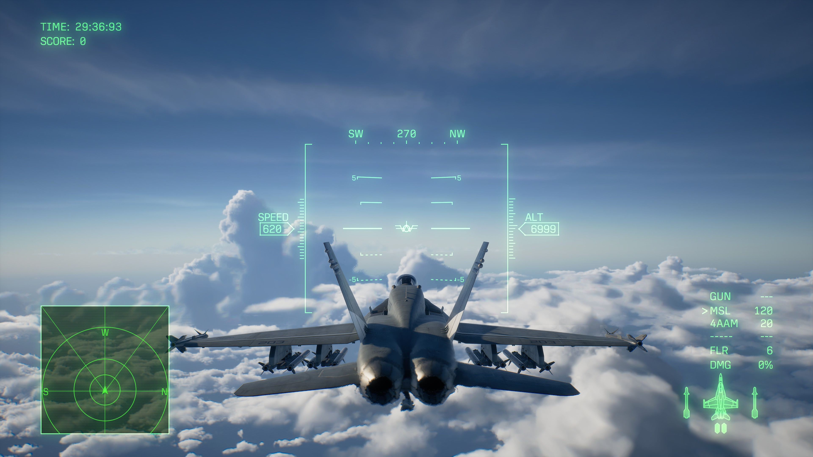

# ACE COMBAT 8 Startup Skip + Third-Person HUD

A Windows x64 launcher that skips the startup notice sequence and keeps the game's native flight instruments updating in third-person chase view. Version **0.2.0** combines both features in one launch; startup skip alone is available with `--no-hud`.

The v0.2.0 test reached the title screen and main menu, and the user confirmed that the startup logos were skipped. Both patches remained active through a normal exit with code 0. Flight HUD motion, alignment, and mission transitions have not been visually verified in v0.2.0. See [validation](docs/VALIDATION.md) for the evidence and remaining checks.



*Historical v0.1.1 screenshot: F/A-18C, Free Flight, San Salvacion North Coast, 13 October 2026. This still image demonstrates the earlier HUD version, not v0.2.0 gameplay.*

## Compatibility

- Windows x64, Steam app **2288340**, build **25201480** only.
- Supported `AceCombat8.exe`: **555,102,832 bytes**, SHA-256 `51510E2A520565DBE81FB0D569E95CD4393077ACAAA859371489B80B8128829F`.
- Offline campaign and single-player use. Detected anti-cheat processes or modules prevent launch or stop monitoring.

The full executable hash, PE layout, Steam build, and five instruction contexts are checked before starting the game. A game update needs a new compatibility review.

## Download and run

Download the v0.2.0 ZIP from [Releases](https://github.com/thunderrun/ace-combat-8-third-person-hud/releases) and extract it into a separate writable folder. The repository copy is under `dist/v0.2.0`.

1. Close ACE COMBAT 8 and let any previous mod launcher finish cleanup. Leave Steam running and signed in.
2. Run `dist/v0.2.0/AC8NoIntroHUD.exe` or `dist/v0.2.0/Launch-Intro-and-HUD.cmd` for both features.
3. Enter campaign or a single-player free mission and switch to chase view using your configured camera control.
4. Keep the launcher open until the game exits. **Ctrl+Alt+F8** toggles only the four HUD changes while the game has focus; startup skip stays enabled.

For startup skip alone, run `dist/v0.2.0/Launch-Intro-Only.cmd` or:

```powershell
.\dist\v0.2.0\AC8NoIntroHUD.exe --no-hud
```

The default game location is the standard Steam library. For another library:

```powershell
.\dist\v0.2.0\AC8NoIntroHUD.exe --game 'D:\SteamLibrary\steamapps\common\ACE COMBAT 8\Game\Binaries\Win64\AceCombat8.exe'
```

No PAK, DLL, or UE4SS installation is needed. Logs and status JSON are created in `logs` beside the launcher; `--output PATH` selects another directory. The previous standalone experimental data-asset intro packages did not skip logos in the reported test. After their game session exits, use their original uninstall tool before switching to this version.

## Scope and removal

Startup skip takes the game's existing notice-completion path. It skips the CESA notice, publisher and middleware logos, manufacturer copyright, fiction disclaimer, and ACES movie. Campaign and gameplay cutscene routines are unchanged.

The HUD changes are the same four comparison bytes as v0.1.1. They permit camera value 2 through the existing native pitch ladder, compass, speed/altitude tape, and aircraft reference mark updates. Camera selection and input bindings are unchanged.

All five changes exist only in the launched game process's memory and disappear when it exits. The launcher does not edit installed game files or write saves; normal gameplay may update saves. To remove it, exit the game and launcher, then delete the extracted folder. Normal Steam launch uses the game's original startup and HUD behavior.

## Check and build

These checks do not launch the game:

```powershell
.\dist\v0.2.0\AC8NoIntroHUD.exe --verify
.\dist\v0.2.0\AC8NoIntroHUD.exe --self-test
```

`--verify` checks the installed executable and all five guarded instruction contexts. `--self-test` runs **21 synthetic cross-process checks**, including executed startup branch behavior, rollback, page protections, foreign-byte preservation, and HUD toggles that leave startup skip active.

To build, install Visual Studio 2022 C++ Build Tools with the Windows SDK, then run from the repository root:

```powershell
.\scripts\build-launcher.ps1 -Test -Output .\build\AC8NoIntroHUD-rebuilt.exe
```

The script expects the standard Visual Studio 2022 Build Tools installation path; adjust `$devCommand` for another installation. Compiler timestamps may change rebuilt binary hashes.

[src/launcher.cpp](src/launcher.cpp) contains the implementation and synthetic tests. [docs/PATCHES.md](docs/PATCHES.md) describes the five bytes, and [CHANGELOG.md](CHANGELOG.md) records version changes. Users supply their own game; game binaries, assets, saves, machine-specific session logs, and third-party tools are excluded.

References from the original HUD investigation: [AC8 Mod Control](https://github.com/JustBlan1984/AC8-Mod-Control), [AC8 UEVR UI fix](https://github.com/lovezzzxxx/ace-combat-8-uevr-ui-fix), and [Ghidra](https://github.com/NationalSecurityAgency/ghidra).
